<p align="center">
  
</p>

<p align="center">
  <samp>CODE × GEOMETRY × CREATIVE COMPUTING</samp>
</p>

<p align="center">
  A small corner of the complex plane.<br />
  在代码与想象之间，保持好奇。
</p>

```text
e-itau@complex-plane:~$ cat /etc/mindset

  explore    →  follow the interesting question
  build      →  turn an idea into something tangible
  iterate    →  make it a little better, one turn at a time
```

<p align="center">
  <samp>Re: make things work. &nbsp; / &nbsp; Im: imagine what comes next.</samp>
</p>

<p align="center">
  
</p>
